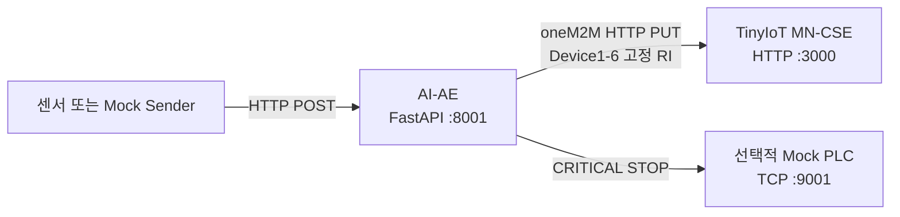

# oneM2M-project

oneM2M 기반 IoT/MEC 안전 모니터링 해커톤 프로젝트입니다. 현재 단일 MEC 환경에서
FastAPI 기반 AI-AE가 센서 데이터를 검증하고 위험도를 평가한 뒤, 같은 컴퓨터의
TinyIoT MN-CSE에 oneM2M HTTP Binding으로 저장합니다.

## 현재 통합 범위

- **AI-AE**: Python/FastAPI 센서 수신, 검증, 위험도 모델 추론, MN-CSE 업데이트
- **MN-CSE**: `MN-CSE/` 루트에 수정된 TinyIoT C 소스 포함, MN-CSE 모드 실행
- **Dashboard**: 별도 개발 완료, 현재 저장소에는 아직 미통합
- 단일 MEC만 대상으로 하며 ID 자동 발견, 다중 MEC 등록/Discovery, Registry는 구현하지 않음
- 이번 통합 범위에 Docker Compose, IN-CSE 및 Dashboard 실행은 포함하지 않음

## 독립 배포 패키지

MEC Package 빌드 및 서비스 관리 자동화를 구현했습니다. 현재 빌드 대상은 **Linux x86_64**이며
AI-AE, TinyIoT MN-CSE, 모델, seed DB와 서비스 관리 도구를 한 패키지로 묶습니다.

주요 구현 파일:

- `packaging/mec/build_package.py`: MN-CSE 빌드, AI-AE와 제어 도구 패키징, seed DB·모델·설정 템플릿 수집,
  패키지 디렉터리와 `.tar.gz` 및 SHA-256 생성
- `packaging/mec/mec_control.py`: 패키지 설정 생성/검증, 최초 runtime DB 준비,
  MN-CSE 준비 대기 후 AI-AE 시작, 상태·health check와 종료 관리
- `packaging/mec/ai_ae_entry.py`: 패키지에 포함되는 AI-AE 실행 진입점
- `packaging/mec/scripts/`: `configure-mec`, `start-mec`, `stop-mec`, `status-mec`, `healthcheck`
- `packaging/mec/templates/.env.example`: 패키지별 설정 템플릿
- `packaging/mec/tests/test_mec_control.py`: 설정 생성 및 검증 테스트
- `packaging/mec/requirements-build.txt`: 패키지 빌드 의존성
- `MN-CSE/util.c`: 실행 시 설정된 서버 주소와 포트를 CSE POA에 반영

**검증 현황:** AI-AE와 MEC 패키지 테스트 27개가 통과했고, WSL에서 Linux x86_64용 MEC 패키지 빌드도
성공했습니다. 다만 새 장비에서 패키지를 풀어 설정·기동·상태 확인·종료하는 설치 수명주기 검증과
실제 LAN에서의 연결 검증은 아직 완료되지 않았습니다. 현재 저장소나 GitHub Release에는 다운로드용
패키지 아카이브가 포함되어 있지 않으므로, 아직 “다운로드 후 바로 배포 가능한 릴리스” 상태는 아닙니다.
빌드·설치 절차와 제한 사항은 [패키징 가이드](docs/PACKAGING.md)를 참고하세요.

Dashboard는 별도 개발 완료 상태이나 소스 코드가 아직 저장소에 통합되지 않아 Dashboard
Package는 만들지 않습니다. 실제 Computer A/B 네트워크 연동도 아직 검증되지 않았습니다.

## 아키텍처와 데이터 흐름



AI-AE는 device1~device5 입력을 검증하고 최신 값을 프로세스 메모리에 유지합니다.
`device3.beam_blocked=true`이고 최신 `device4.is_rotating=true`이면 Device1, 4, 5 값으로
분류 모델을 실행하고 결과를 Device6 Risk FlexContainer에 씁니다. `CRITICAL`은 모의 PLC
STOP 경로도 실행합니다. 모델은 합성 규칙 데이터로 학습된 데모용이며 실제 안전 성능이
검증된 모델은 아닙니다.

AI-AE는 CSE 리소스를 자동 생성하지 않습니다. 기존 seed DB의 Device1~Device6 Resource ID를
고정 사용하며 build 단계에서 `.env`와 DB의 ID 및 payload 필드를 검증합니다.
자세한 내용은 [아키텍처](docs/ARCHITECTURE.md)와 [배포 가이드](docs/DEPLOYMENT.md)를
참고하세요.

## 디렉터리 구조

```text
oneM2M-project/
├── .env.example
├── README.md
├── AI-AE/
│   ├── mec_safety/
│   ├── requirements.txt
│   └── tests/
├── MN-CSE/                       # TinyIoT 소스 루트 (MN-CSE/tinyIoT 아님)
│   ├── app/ resources/ sqlite/ sdt_definitions/ ...
│   ├── config.h.in Makefile.in configure.ac
│   ├── data.db                    # 고정 리소스가 포함된 seed DB
│   └── scripts/
│       ├── build.py
│       └── run.py
├── packaging/
│   └── mec/                       # Linux x86_64 MEC Package 빌드/실행 도구
│       ├── build_package.py
│       ├── mec_control.py
│       ├── ai_ae_entry.py
│       ├── requirements-build.txt
│       ├── scripts/               # configure/start/stop/status/healthcheck
│       ├── templates/.env.example
│       └── tests/test_mec_control.py
└── docs/
    ├── ARCHITECTURE.md
    ├── CONFIGURATION.md
    ├── DEPLOYMENT.md
    ├── DEVELOPMENT.md
    └── PACKAGING.md
```

MN-CSE 런타임은 seed DB를 직접 수정하지 않도록 `MN-CSE/runtime/data.db`에서 실행됩니다.
첫 실행 시 seed DB를 복사하고, 다음 실행에서는 기존 runtime DB를 유지합니다.

## 개발 및 실행 (WSL Ubuntu)

개발과 실동작 검증은 TinyIoT MN-CSE, AI-AE, Mock PLC, Mock Sensor Sender와 pytest 모두
같은 WSL Ubuntu 환경에서 수행합니다. 현재 저장소 경로가 `/mnt/c/` 아래라면 빌드 및
Python 패키지 설치가 느릴 수 있습니다. 새 작업용 checkout은 `~/projects/oneM2M-project`
같은 Linux 파일시스템 경로를 권장하지만, 기존 작업 파일은 임의로 이동하지 마세요.

MN-CSE 빌드에는 `gcc`, `make`, `pkg-config`, `libssl-dev`, `libwebsockets-dev`가 필요합니다.
AI-AE는 저장소 루트 `.env`를 `python-dotenv`로 읽으며, `.env`의 실제 값을 공유하거나
출력하지 마세요. 생성되는 `MN-CSE/config.h`와 `Makefile`은 직접 편집하지 않습니다.

### 1. WSL 의존성과 AI-AE venv 준비

```bash
sudo apt-get update
sudo apt-get install -y build-essential pkg-config libssl-dev libwebsockets-dev python3-venv
cd AI-AE
python3 -m venv .venv
source .venv/bin/activate
python -m pip install -r requirements.txt
```

### 2. MN-CSE 빌드 및 실행

프로젝트 루트에서 실행합니다. 빌드 검증은 `.env`의 필수 설정과 seed DB의 CSE Base,
Device1~Device6 Resource ID 및 FlexContainer 필드를 비교한 다음 `config.h`와 `Makefile`을
생성하고 GCC로 `MN-CSE/server`를 빌드합니다.

```bash
cd "$(git rev-parse --show-toplevel)"
python3 MN-CSE/scripts/build.py
python3 MN-CSE/scripts/run.py
```

`run.py`는 runtime DB가 없을 때만 seed를 복사하고, 기존 DB는 덮어쓰지 않습니다. 서버를
실행한 터미널은 유지합니다. listener는 `0.0.0.0:3000`에 열리고 AI-AE는 로컬
`http://127.0.0.1:3000`을 사용합니다. `TINYIOT_SERVER_IP`는 CSE POA 광고 주소입니다.

### 3. Mock PLC 및 AI-AE 실행

각각 별도의 WSL 터미널에서 실행하고, **Mock PLC를 먼저 시작**합니다.

```bash
cd AI-AE
source .venv/bin/activate
python -m mec_safety.demo_plc_server
```

다른 WSL 터미널에서 AI-AE를 시작합니다.

```bash
cd AI-AE
source .venv/bin/activate
python -m uvicorn mec_safety.app:app --host 127.0.0.1 --port 8001
```

### 4. 상태, 연결 및 센서 update 확인

```bash
curl -fsS http://127.0.0.1:8001/health
cd AI-AE
source .venv/bin/activate
python tests/check_cse_connection.py
python -m mec_safety.send_mock_data --once
```

연결 검사는 CSE Base와 Device1~Device6의 HTTP/RSC, Resource ID 일치, FlexContainer wrapper와
field schema를 확인합니다. `.env` 값과 Resource ID 자체는 출력하지 않습니다. Mock Sender는
측정값만 전송하며, 마지막 Device3 요청 뒤 ML 위험도와 Device6 update를 확인합니다. 이는
runtime DB를 변경합니다. 반복 전송은 `--once`를 빼고 `--interval-seconds 1`을 지정합니다.

실행 중인 서비스를 재시작하거나 DB를 초기화하지 않고 통합 확인만 하려면 프로젝트 루트에서
다음을 실행합니다.

```bash
cd "$(git rev-parse --show-toplevel)"
bash scripts/verify-mec.sh
```

이 검증기는 AI-AE health, CSE 연결, Mock Sensor 1회 전송, 위험도 update 및 runtime DB 변경을
검사합니다. 모델이 예측한 CRITICAL 샘플이 있을 때만 Mock PLC STOP 응답을 확인하고, 없으면
해당 항목을 미실행으로 표시합니다.

### 5. pytest 및 종료

```bash
cd AI-AE
source .venv/bin/activate
python -m pytest -q
```

MN-CSE, AI-AE, Mock PLC는 각자 실행 중인 WSL 터미널에서 `Ctrl+C`로 종료합니다. 주요 포트는
MN-CSE TCP `3000`, AI-AE HTTP `8001`, Mock PLC TCP `9001`입니다.

### WSL 실동작 검증 결과

이번 WSL 실행에서 MN-CSE의 GCC 빌드와 기동, runtime DB 최초 생성, SDT definition 로드
(807개/21개 파일), AI-AE health, CSE Base 및 Device1~Device6 GET/schema 검증이 성공했습니다.
`scripts/verify-mec.sh`에서는 다섯 센서 update와 Device6 Risk update가 성공했고, 모델 예측
CRITICAL 입력에 대해서도 Device6 전달과 Mock PLC의 `STOP_ACCEPTED` 및 `STOPPED` 응답을
확인했습니다. seed DB는 변경되지 않았습니다.

AI-AE pytest 결과는 **22 passed**, Starlette/AnyIO deprecation warning 1건입니다. 이 결과는
동일 WSL 환경의 이번 실행에 한정되며, 별도 컴퓨터 간 LAN 통신이나 Dashboard 연동을 검증한
것은 아닙니다.

## 설정 및 세부 문서

- [환경변수 설정](docs/CONFIGURATION.md)
- [실제 배포 순서와 상태 확인](docs/DEPLOYMENT.md)
- [컴포넌트 구조 및 데이터 흐름](docs/ARCHITECTURE.md)
- [개발과 테스트](docs/DEVELOPMENT.md)
- [AI-AE 상세 동작](AI-AE/README.md)
- [MN-CSE 빌드/실행](MN-CSE/README.md)
