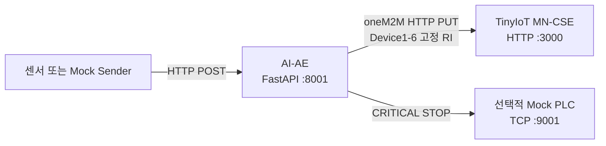

# oneM2M-project

oneM2M 기반 IoT/MEC 안전 모니터링 해커톤 프로젝트입니다. 현재 단일 MEC 환경에서
FastAPI 기반 AI-AE가 센서 데이터를 검증하고 위험도를 평가한 뒤, 같은 컴퓨터의
TinyIoT MN-CSE에 oneM2M HTTP Binding으로 저장합니다.

## 현재 통합 범위

- **AI-AE**: Python/FastAPI 센서 수신, 검증, 위험도 모델 추론, MN-CSE 업데이트
- **MN-CSE**: `MN-CSE/` 루트에 수정된 TinyIoT C 소스 포함, MN-CSE 모드 실행
- **Dashboard**: 별도 개발 완료, 현재 저장소에는 아직 미통합
- 단일 MEC만 대상으로 하며 ID 자동 발견, 다중 MEC 등록/Discovery, Registry는 구현하지 않음
- 이번 통합 범위에 Docker Compose, IN-CSE 및 Dashboard 실행은 포함하지 않음

## 아키텍처와 데이터 흐름



AI-AE는 device1~device5 입력을 검증하고 최신 값을 프로세스 메모리에 유지합니다.
`device3.beam_blocked=true`이고 최신 `device4.is_rotating=true`이면 Device1, 4, 5 값으로
분류 모델을 실행하고 결과를 Device6 Risk FlexContainer에 씁니다. `CRITICAL`은 모의 PLC
STOP 경로도 실행합니다. 모델은 합성 규칙 데이터로 학습된 데모용이며 실제 안전 성능이
검증된 모델은 아닙니다.

AI-AE는 CSE 리소스를 자동 생성하지 않습니다. 기존 seed DB의 Device1~Device6 Resource ID를
고정 사용하며 build 단계에서 `.env`와 DB의 ID 및 payload 필드를 검증합니다.
자세한 내용은 [아키텍처](docs/ARCHITECTURE.md)와 [배포 가이드](docs/DEPLOYMENT.md)를
참고하세요.

## 디렉터리 구조

```text
oneM2M-project/
├── .env.example
├── README.md
├── AI-AE/
│   ├── mec_safety/
│   ├── requirements.txt
│   └── tests/
├── MN-CSE/                       # TinyIoT 소스 루트 (MN-CSE/tinyIoT 아님)
│   ├── app/ resources/ sqlite/ sdt_definitions/ ...
│   ├── config.h.in Makefile.in configure.ac
│   ├── data.db                    # 고정 리소스가 포함된 seed DB
│   └── scripts/
│       ├── build.py
│       └── run.py
└── docs/
    ├── ARCHITECTURE.md
    ├── CONFIGURATION.md
    ├── DEPLOYMENT.md
    └── DEVELOPMENT.md
```

MN-CSE 런타임은 seed DB를 직접 수정하지 않도록 `MN-CSE/runtime/data.db`에서 실행됩니다.
첫 실행 시 seed DB를 복사하고, 다음 실행에서는 기존 runtime DB를 유지합니다.

## 개발 및 실행

MN-CSE 빌드는 WSL/Linux 환경에서 수행합니다. 필요한 도구와 라이브러리는 `gcc`, `make`,
`pkg-config`, OpenSSL 개발 라이브러리 및 `libwebsockets` 개발 라이브러리입니다.
현재 빌드 스크립트는 프로젝트 루트 `.env`와 `config.h.in`, `Makefile.in`을 이용해
빌드 설정을 생성합니다. `config.h`는 생성 결과이며 직접 편집하지 않습니다.

### 1. 설정 및 MN-CSE 빌드 (WSL)

프로젝트 루트에서 실행합니다. 최초 로컬 설정 옵션은 지정된 loopback 연결값과 seed DB의 Base RI를 설정하고
기존 `AE_ID`와 Device Resource ID는 보존합니다. seed DB에 없는 CSE Base SP ID는 별도로
확인하여 `.env`에 설정해야 합니다.

```bash
python3 MN-CSE/scripts/build.py --init-local-env
```

이후 설정을 다시 덮어쓰지 않고 빌드하려면 다음을 사용합니다.

```bash
python3 MN-CSE/scripts/build.py
```

### 2. MN-CSE 실행 (WSL)

```bash
python3 MN-CSE/scripts/run.py
```

MN-CSE는 HTTP `3000` 포트에서 실행됩니다. 서버는 `0.0.0.0`에 bind하고,
`TINYIOT_SERVER_IP`는 CSE의 POA에 광고됩니다. 같은 컴퓨터의 AI-AE는
`http://127.0.0.1:3000`으로 연결합니다.

### 3. AI-AE 실행 (PowerShell)

```powershell
cd AI-AE
python -m pip install -r requirements.txt
python -m uvicorn mec_safety.app:app --host 127.0.0.1 --port 8001
```

AI-AE와 MN-CSE는 동일한 프로젝트 루트 `.env` 설정을 사용합니다. AI-AE 주소와 고정
Resource ID는 민감한 값이므로 `.env`를 공유하거나 커밋하지 마세요.

### 4. Mock Sensor 데이터 전송

AI-AE 디렉터리의 별도 PowerShell에서 한 샘플을 전송합니다.

```powershell
python -m mec_safety.send_mock_data --once
```

반복 전송은 `--once` 없이 `--interval-seconds 1`을 지정합니다. 이는 실제 runtime DB를
업데이트합니다.

### 5. 상태 및 연결 확인

AI-AE:

```powershell
curl.exe http://127.0.0.1:8001/health
```

MN-CSE Base와 six FlexContainer를 GET으로 검사:

```powershell
cd AI-AE
python tests\check_cse_connection.py
```

AI-AE 자동 테스트:

```powershell
cd AI-AE
python -m pytest -q
```

## 설정 및 세부 문서

- [환경변수 설정](docs/CONFIGURATION.md)
- [실제 배포 순서와 상태 확인](docs/DEPLOYMENT.md)
- [컴포넌트 구조 및 데이터 흐름](docs/ARCHITECTURE.md)
- [개발과 테스트](docs/DEVELOPMENT.md)
- [AI-AE 상세 동작](AI-AE/README.md)
- [MN-CSE 빌드/실행](MN-CSE/README.md)
