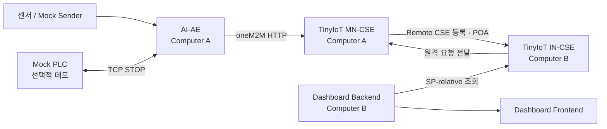

# PinchGuard · oneM2M-project

> **IoT / MEC 안전 모니터링 해커톤 프로젝트**
> AI-AE가 센서 입력을 검증하고 위험도를 추론해 oneM2M 리소스를 갱신하며, 별도
> Monitoring Node의 Dashboard가 CSE 경유로 상태를 보여주는 통합 시제품입니다.

현재 저장소에는 AI-AE, TinyIoT MN-CSE, TinyIoT IN-CSE, PinchGuard Dashboard 소스와
두 개의 독립 배포 패키지 빌더가 통합되어 있습니다. 아래 문서는 현재 구현과 검증되지 않은
배포 가정을 구분합니다.

## 목차

1. [프로젝트 한눈에 보기](#01--프로젝트-한눈에-보기)
2. [시스템 아키텍처와 데이터 흐름](#02--시스템-아키텍처와-데이터-흐름)
3. [컴포넌트](#03--컴포넌트)
4. [저장소 구조](#04--저장소-구조)
5. [배포 패키지와 설치자 설정](#05--배포-패키지와-설치자-설정)
6. [현재 통합·검증 상태](#06--현재-통합검증-상태)
7. [WSL 개발 및 실행](#07--wsl-개발-및-실행)
8. [제한과 다음 단계](#08--제한과-다음-단계)

## 01 / 프로젝트 한눈에 보기

목표는 단일 MEC를 기준으로 센서 데이터와 위험 판단을 oneM2M 리소스로 공유하고, 다른
장비에서 모니터링하는 것입니다. MEC는 인프라/실행 노드이며, AI-AE는 그 위에서 동작하는
애플리케이션입니다.

| 역할 | 배치 | 주요 책임 |
|---|---|---|
| MEC Node (Computer A) | AI-AE + TinyIoT MN-CSE | 센서 처리·위험 추론, oneM2M 리소스 저장 및 원격 CSE 등록 |
| Monitoring Node (Computer B) | TinyIoT IN-CSE + PinchGuard Dashboard | MEC 등록 수락·요청 라우팅, 상태 및 이벤트 시각화 |

## 02 / 시스템 아키텍처와 데이터 흐름



1. 센서 또는 Mock Sender가 AI-AE의 HTTP API에 Device1~Device5 입력을 보냅니다.
2. AI-AE는 입력을 검증하고 trigger 조건에 따라 위험도를 추론합니다.
3. AI-AE는 Seed DB에 미리 정의된 FlexContainer Resource ID에 oneM2M 업데이트를 요청합니다.
4. MEC MN-CSE는 설정된 IN-CSE endpoint에 Remote CSE 등록을 시도합니다.
5. Dashboard Backend는 같은 Monitoring Node의 IN-CSE에 `/~/<MN-CSE-ID>/DeviceN` 경로로
   조회하고, IN-CSE가 등록된 MEC MN-CSE로 요청을 전달합니다.
6. Frontend는 센서·위험 데이터와 연결 상태를 표시합니다.

AI-AE의 MN-CSE 주소는 같은 Computer A의 loopback을 사용할 수 있습니다. Computer B에서
MEC에 접근할 때는 POA에 설정한 MEC의 내부망 주소를 사용해야 하며, 원격 주소로
`127.0.0.1`을 사용하지 않습니다. 상세 통신과 미확정 가정은
[아키텍처 문서](docs/ARCHITECTURE.md)를 참고하세요.

## 03 / 컴포넌트

### AI-AE

FastAPI 기반 oneM2M Application Entity입니다. 센서 payload schema 검증, 최신 장치 값 관리,
Device3 beam trigger와 Device4 회전 상태 기반 위험도 추론, Device1~Device6 FlexContainer
업데이트를 담당합니다. 모델이 `CRITICAL`을 예측한 경우 선택적으로 Mock PLC TCP STOP 데모를
요청합니다. Resource ID는 Seed DB와 설정에 고정되어 있으며 자동 discovery를 하지 않습니다.

### TinyIoT MN-CSE

MEC Node의 oneM2M Middle Node CSE입니다. Seed DB 리소스를 제공하고 AI-AE 요청을 받으며,
Monitoring Node의 IN-CSE에 Remote CSE 등록을 재시도합니다. listener는 외부 연결을 수신하고,
POA에는 운영자가 지정한 MEC 주소를 광고합니다.

### TinyIoT IN-CSE

Monitoring Node의 Infrastructure Node CSE입니다. 허용된 MEC MN-CSE의 등록 정보를 관리하고,
SP-relative 원격 조회 요청을 해당 MN-CSE로 전달합니다. Dashboard의 Originator에는 IN-CSE
초기 AccessControl 설정에 따라 조회 권한만 부여하는 배포 구성을 사용합니다.

### PinchGuard Dashboard

Monitoring Node에서 Backend와 정적 Frontend를 제공합니다. IN-CSE를 통한 원격 센서/위험도
조회, 상태 표시, 이벤트 기록 및 SQLite 기반 로컬 데이터 기능을 포함합니다. 구체적인 UI/API
범위는 [Dashboard 통합 문서](Dashboard/README_MN_CSE_INTEGRATION.md)를 참고하세요.

이 프로젝트는 해커톤 시제품이며 의료·산업 안전 인증 또는 PLC 안전 제어 시스템이 아닙니다.
실제 현장 적용 전에 독립적인 위험성 평가와 보안 검토가 필요합니다.

## 04 / 저장소 구조

```text
oneM2M-project/
├── AI-AE/                  # FastAPI AE, ML 모델, mock 도구, 테스트
├── MN-CSE/                 # TinyIoT MN-CSE 소스, Seed DB, build/run 스크립트
├── IN-CSE/                 # TinyIoT IN-CSE 소스, build/run 스크립트
├── Dashboard/              # PinchGuard Backend, static frontend, 테스트
├── packaging/
│   ├── mec/                # AI-AE + MN-CSE MEC 패키지
│   └── monitoring/         # IN-CSE + Dashboard Monitoring 패키지
├── scripts/                # WSL MEC 실동작 검증 스크립트
├── docs/                   # 아키텍처·배포·설정·개발·패키징 문서
├── .env.example            # 저장소 개발/빌드 설정 템플릿
└── README.md
```

## 05 / 배포 패키지와 설치자 설정

두 패키지는 서로 다른 장비에 설치할 수 있고 서로의 `.env`를 공유하지 않습니다.

| 다운로드 단위 | 포함 컴포넌트 | 패키지별 안내 |
|---|---|---|
| MEC Package | AI-AE + TinyIoT MN-CSE + 모델/Seed DB | [설치·설정·실행](packaging/mec/README.md) |
| Monitoring Package | TinyIoT IN-CSE + Dashboard | [설치·설정·실행](packaging/monitoring/README.md) |

현재 빌더는 Linux x86_64를 대상으로 합니다. 운영자는 패키지 압축을 푼 뒤 `configure-*`로
개별 설정 파일을 생성하고, 자기 장비의 내부망 주소, AI-AE/IN-CSE Originator,
Dashboard ingest key 및 MEC↔Monitoring endpoint를 입력합니다. 고정 CSE identity,
Seed-derived Resource ID, RVI/SP 정보는 패키지 metadata와 일치해야 하며 임의로 바꾸면 안
됩니다. 실제 값은 README나 로그에 복사하지 마세요.

사용자가 프로젝트 개발 의존성을 설치할 필요가 없는 배포가 목표지만, 빌드된 패키지를
깨끗한 별도 장비에서 설치하고 두 컴퓨터 간 연결을 검증하는 작업은 아직 필요합니다.
GitHub Release가 게시된 것으로 간주하지 마세요. 자세한 배포 절차는
[배포 가이드](docs/DEPLOYMENT.md), 빌드 구조는 [패키징 가이드](docs/PACKAGING.md)에
정리했습니다.

## 06 / 현재 통합·검증 상태

| 항목 | 현재 상태 |
|---|---|
| AI-AE ↔ MEC MN-CSE 및 Mock PLC | WSL 통합 검증 완료(이전 확인 결과 기준) |
| IN-CSE / Dashboard 단위 테스트 | 테스트 실행 환경에서 통과(이전 확인 결과 기준) |
| 패키지 빌더와 제어 스크립트 | 구현됨. 이번 변경에 대한 targeted test/build는 아래 작업 보고의 검증 결과 참고 |
| Computer A ↔ Computer B 실제 LAN 연동 | 미검증 |
| 새 Linux 장비에서 아카이브 설치·재부팅·업데이트 | 미검증 |
| GitHub Releases | 게시 전 |

단일 WSL 환경 테스트는 서로 다른 컴퓨터의 라우팅, 방화벽, advertised POA, 재부팅 후
복구를 대신하지 않습니다. 테스트 시점과 결과를 구분해 기록하며 실행하지 않은 항목을 통과로
표시하지 않습니다.

## 07 / WSL 개발 및 실행

개발 및 네이티브 빌드 기준은 WSL Ubuntu/Linux입니다. 저장소가 `/mnt/c/`에 있다면 새
checkout에는 `~/projects/oneM2M-project` 같은 WSL Linux 경로를 권장합니다. 기존 파일을
임의로 이동하거나 덮어쓰지 마세요.

```bash
sudo apt-get update
sudo apt-get install -y build-essential pkg-config libssl-dev libwebsockets-dev python3-venv
cp .env.example .env
```

AI-AE 단위 테스트:

```bash
cd AI-AE
python3 -m venv .venv
source .venv/bin/activate
python -m pip install -r requirements.txt
python -m pytest -q
```

MN-CSE를 포함한 MEC 통합 실행은 루트 `.env`와 Seed DB를 먼저 준비합니다.

```bash
# 프로젝트 루트
python3 MN-CSE/scripts/build.py
python3 MN-CSE/scripts/run.py
```

실제 배포 패키지 빌드/실행 명령, IN-CSE와 Dashboard 개발 절차는
[개발 가이드](docs/DEVELOPMENT.md)와 각 패키지 README를 따릅니다. 설정 변수의 의미는
[환경설정 문서](docs/CONFIGURATION.md)를 확인하세요.

## 08 / 제한과 다음 단계

- 실제 2대 장비에서 Remote CSE 등록, POA forwarding, Dashboard 조회를 end-to-end 검증
- 깨끗한 Linux 장비에서 패키지 설치, 데이터 보존, 정상 종료 및 업그레이드 검증
- 검증한 OS/아키텍처만 명시하여 GitHub Release와 SHA-256 게시
- 설치자 Originator/ACP 정책, TLS 또는 VPN, 방화벽 및 secret rotation 운영 방안 확정
- 필요 시 서비스 자동 시작/로그 회전 등 운영 편의 기능 검토

다중 MEC discovery, 자동 MEC 선택, failover 및 Docker Compose 배포는 현재 배포 범위에
포함하지 않습니다.

## 문서

- [전체 아키텍처](docs/ARCHITECTURE.md)
- [배포 가이드](docs/DEPLOYMENT.md)
- [환경변수 설정](docs/CONFIGURATION.md)
- [개발 가이드](docs/DEVELOPMENT.md)
- [독립 패키징 가이드](docs/PACKAGING.md)
- [AI-AE](AI-AE/README.md) · [MN-CSE](MN-CSE/README.md) · [IN-CSE](IN-CSE/README.md)
- [Dashboard ↔ IN-CSE 연동](Dashboard/README_MN_CSE_INTEGRATION.md)
