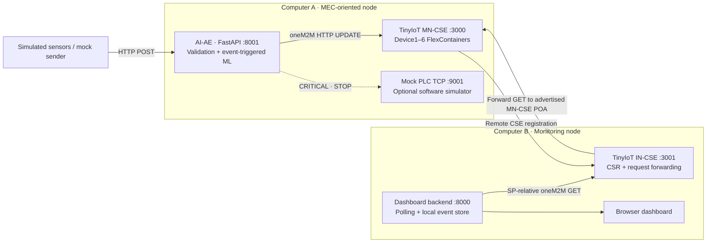
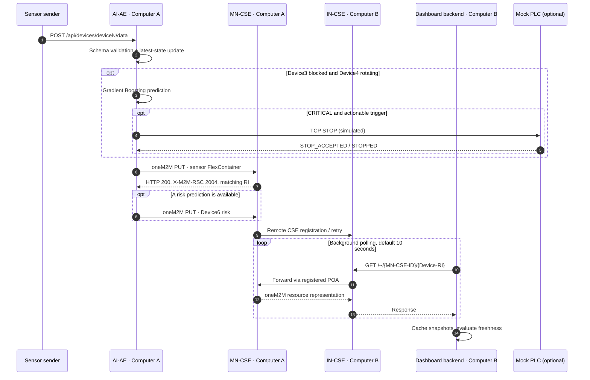

# PinchGuard

**oneM2M-Based Industrial Safety Monitoring · Edge Risk Inference · Two-Node IoT Integration**

**Team Just Do It · Sejong University · 2026 oneM2M International Developer Competition**

[](https://github.com/seungwon20/oneM2M-project/releases/tag/v0.1.0-hackathon) [](https://github.com/seungwon20/oneM2M-project/releases/tag/v0.1.0-hackathon) [](https://www.onem2m.org/) [](#scope-and-validation-status)

**[Download Linux packages](https://github.com/seungwon20/oneM2M-project/releases/tag/v0.1.0-hackathon)** · **[Install](#install-the-published-packages)** · **[Architecture](#architecture)** · **[Source code](#repository-map)** · **[Testing](#verification-and-evidence)** · **[oneM2M design](#onem2m-resource-model)**

> [!IMPORTANT]
> **A research and hackathon software prototype—not a certified industrial safety controller.** Inputs in the demonstrated scenario are simulated. The risk classifier was trained on synthetic, rule-labeled samples. The PLC STOP response is simulated; no physical emergency stop, occupational safety certification, or industrial field accuracy is claimed.

## Overview

**PinchGuard** combines an edge-hosted application, standardized oneM2M resources, remote CSE request routing, and a monitoring web application to study industrial worker–machine risk scenarios.

The project has **two separately deployable nodes**:

| Node | Runtime components | Purpose |
|:--|:--|:--|
| **Computer A — MEC-oriented node** | FastAPI **AI-AE** + modified **TinyIoT MN-CSE** | Validate sensor measurements, conditionally infer risk, update oneM2M FlexContainers, and optionally send a simulated PLC STOP |
| **Computer B — Monitoring node** | **TinyIoT IN-CSE** + **PinchGuard Dashboard** | Accept remote-CSE registration, route oneM2M read requests to the MN-CSE, poll six device resources, and display telemetry, status, and events |

The source for **all four primary components** is present on the [`integration/in-cse-dashboard` branch](https://github.com/seungwon20/oneM2M-project/tree/integration/in-cse-dashboard). The two Linux x86_64 binary archives and their SHA-256 files are published in [release `v0.1.0-hackathon`](https://github.com/seungwon20/oneM2M-project/releases/tag/v0.1.0-hackathon); the release tag and this branch currently identify the **same source commit**.

The term **MEC-oriented** refers to the placement of analytics close to the CSE on an edge node. This code does **not** establish operational ETSI MEC platform service registration, orchestration, or safety-certified equipment control.

### System at a glance



**Interpret the arrows carefully:** remote registration and IN-CSE forwarding are **implemented in source**. The release notes report both packages tested together within **one WSL environment over loopback**. A deployment to two physically separate computers, including LAN routing and firewall behavior, has **not** been validated by those results.


## Contents

- [Published packages](#published-packages)
- [Architecture](#architecture)
- [oneM2M resource model](#onem2m-resource-model)
- [AI inference and simulated response](#ai-inference-and-simulated-response)
- [Install the published packages](#install-the-published-packages)
- [Configure the two nodes](#configure-the-two-nodes)
- [Verify a running deployment](#verify-a-running-deployment)
- [Build and test from source](#build-and-test-from-source)
- [Dashboard functionality and APIs](#dashboard-functionality-and-apis)
- [Security and data handling](#security-and-data-handling)
- [Verification and evidence](#verification-and-evidence)
- [Scope and validation status](#scope-and-validation-status)
- [Repository map](#repository-map)
- [2026 evaluation alignment](#2026-evaluation-alignment)
- [References](#references)

## Published packages

The public [**Hackathon Linux Packages v0.1.0** pre-release](https://github.com/seungwon20/oneM2M-project/releases/tag/v0.1.0-hackathon) provides **four assets**: two archives and their individual SHA-256 files.

| Download | Included software | Approx. archive size | Checksum |
|:--|:--|--:|:--|
| [**MEC-Package-Linux-x86_64.tar.gz**](https://github.com/seungwon20/oneM2M-project/releases/download/v0.1.0-hackathon/MEC-Package-Linux-x86_64.tar.gz) | AI-AE, TinyIoT MN-CSE, model, seed DB, SDT definitions and service scripts | 544 MB | [SHA-256](https://github.com/seungwon20/oneM2M-project/releases/download/v0.1.0-hackathon/MEC-Package-Linux-x86_64.tar.gz.sha256) |
| [**Monitoring-Package-Linux-x86_64-final.tar.gz**](https://github.com/seungwon20/oneM2M-project/releases/download/v0.1.0-hackathon/Monitoring-Package-Linux-x86_64-final.tar.gz) | TinyIoT IN-CSE, Dashboard backend/frontend and service scripts | 243 MB | [SHA-256](https://github.com/seungwon20/oneM2M-project/releases/download/v0.1.0-hackathon/Monitoring-Package-Linux-x86_64-final.tar.gz.sha256) |

Both archives are **GitHub Release assets**, not Git-tracked generated binaries. The source builders are [MEC](packaging/mec/build_package.py) and [Monitoring](packaging/monitoring/build_package.py). Their outputs target **Linux x86_64 only**. The presence of an archive and a checksum does not establish independent host compatibility, end-to-end network security, or a cryptographically signed supply chain.

**Archive naming:** the published Monitoring download has `-final` in its *archive filename*, while its source [package builder](packaging/monitoring/build_package.py) uses the internal directory name `Monitoring-Package-Linux-x86_64`. Do not assume both strings are interchangeable when changing directories.

## Architecture

### Responsibility boundaries

1. **Sensor input:** a mock sender submits measurements for Device1–5 to the AI-AE over HTTP. The receiver rejects unknown fields, missing required fields and type mismatches.
2. **Local analytics:** the AI-AE stores the latest valid values in process memory. A Device3 beam-blocked update, together with an existing Device4 rotating-belt state, gates execution of the trained classifier.
3. **oneM2M update:** Layer 2 runs **in the same FastAPI process** and sends a oneM2M HTTP `PUT` to the configured existing FlexContainer Resource ID. The AI-AE does not dynamically register an AE or bootstrap the six resources.
4. **Remote CSE:** the MN-CSE is configured to register with the IN-CSE. Its registration worker retries when the IN-CSE is temporarily unavailable.
5. **Dashboard access:** the Dashboard backend polls the IN-CSE through a **oneM2M SP-relative path**; the IN-CSE forwards the request to the registered MN-CSE using its advertised POA. The web browser talks to the Dashboard backend, not directly to the MN-CSE.
6. **Optional response:** on a model-predicted **CRITICAL** risk, the AI-AE requests a direct TCP STOP from a Mock PLC, which can return simulated `STOP_ACCEPTED` and `STOPPED` messages.

### Request routing



> **Implementation order matters:** the [FastAPI handler](AI-AE/mec_safety/app.py) attempts the optional Mock PLC STOP **before** forwarding the sensor and risk updates to the CSE. These actions are not an atomic transaction. A PLC simulator response cannot be treated as proof that a CSE update succeeded, or vice versa.

### Address selection

| Communication | Address rule |
|:--|:--|
| AI-AE → local MN-CSE | `CSE_BASE_URL=http://127.0.0.1:3000` in the default same-node setup |
| MN-CSE advertised POA | `TINYIOT_SERVER_IP` must be reachable from Computer B |
| MN-CSE → IN-CSE | `REMOTE_CSE_HOST` and `REMOTE_CSE_PORT` target Computer B |
| Dashboard backend → local IN-CSE | `PG_IN_CSE_URL=http://127.0.0.1:3001` when both are on Computer B |
| Browser → Dashboard | `http://<monitoring-node-address>:8000` by default |

Both CSE HTTP listeners may bind to `0.0.0.0`; a **POA-advertised address is not the same concept as a listener bind address**. `127.0.0.1` is never a valid *remote computer's* address.

## oneM2M resource model

PinchGuard uses six **predefined SDT-backed FlexContainers** (resource type `ty=28`) hosted by the TinyIoT MN-CSE. The specialized resource definitions are in [edgeguard_Device1-Device6.fcp](MN-CSE/sdt_definitions/edgeguard_Device1-Device6.fcp); the CSE implementation performs schema validation in [`sdt.c`](MN-CSE/sdt.c) and [`resources/fcnt.c`](MN-CSE/resources/fcnt.c).

| Resource | Represents | Application-specific attributes |
|:--|:--|:--|
| **Device1** · Camera-derived counts | Workers in/around the monitoring zone | `zone_person_count`, `total_person_count`, `received_at` |
| **Device2** · Weight | Weight measurement | `weight_kg`, `received_at` |
| **Device3** · Infrared | Beam interruption / inference gate | `beam_blocked`, `received_at` |
| **Device4** · Encoder | Conveyor motion | `is_rotating`, `speed_rpm`, `received_at` |
| **Device5** · Proximity | Distance measurement | `distance_cm`, `received_at` |
| **Device6** · Risk | Predicted risk and context | `risk_level`, `speed_rpm`, `distance_cm`, `evaluated_at` |

The `received_at` and `evaluated_at` fields are added by the application handoff. They are **not** expected in the inbound sensor JSON. The in-process latest-state snapshot retains measurement fields rather than oneM2M metadata.

### oneM2M write semantics

- **Method:** HTTP `PUT` to a preconfigured FlexContainer Resource ID. The AI-AE is not a general-purpose oneM2M resource creator, explorer, subscription manager or CSE registrar.
- **Content wrapper:** resource-specific `eg:Device1` through `eg:Device6` wrappers, not a generic proprietary payload without a oneM2M resource type.
- **Headers:** `X-M2M-Origin`, `X-M2M-RI`, `X-M2M-RVI`, and `Content-Type: application/json`.
- **Success contract:** HTTP `200`, `X-M2M-RSC: 2004` and a response `X-M2M-RI` equal to the sent request ID. A failed CSE handoff is surfaced by the API rather than silently reported as success.
- **Storage:** the MN-CSE writes FlexContainer data to its SQLite **runtime** database; the bundled seed DB is a template, not the active database.

Example request to the **AI-AE input API** (this is not a direct oneM2M request):

```bash
curl -fsS -X POST 'http://127.0.0.1:8001/api/devices/device1/data' -H 'Content-Type: application/json' -d '{"zone_person_count":2,"total_person_count":5}'
```

### Remote retrieval through IN-CSE

The backend builds a oneM2M path using the configured remote MN-CSE identifier **and Resource ID**:

```text
GET http://127.0.0.1:3001/~/<MN-CSE-ID>/<Device-Resource-ID>
X-M2M-Origin: <configured-dashboard-originator>
X-M2M-RI: <unique-request-id>
X-M2M-RVI: 3
```

The device-specific Resource IDs are loaded from package build metadata and corresponding configuration fields. The Dashboard polls Device1–6 independently and isolates per-device failures; a successful HTTP poll does **not** mean the underlying sensor reading is fresh. The [backend implementation](Dashboard/app.py) caches the last completed poll and exposes its result via `/api/onem2m/devices`.

### Why oneM2M instead of an application-only REST data store?

The oneM2M layer gives the prototype a standardized CSE/resource relationship, specialized SDT representations and standard protocol headers/status conventions. The IN-CSE also provides a routing boundary for the Dashboard, rather than requiring each UI component to speak directly to every device. However, **having this design is not proof of automatic discovery, advanced Group/Announcement services, cross-CSE state synchronization, or failover**. Those features must be separately implemented and demonstrated to claim them.

## AI inference and simulated response

The AI-AE includes a packaged [scikit-learn Gradient Boosting classifier](AI-AE/mec_safety/train_risk_model.py). Its training script reads **200 synthetic heuristic-labeled samples** (50 for each of `LOW`, `MEDIUM`, `HIGH`, and `CRITICAL`), evaluates a stratified 80/20 split, and writes a model trained on all samples for the demo. These data are **not a validated occupational safety dataset**.

**Inference gate:** an incoming Device3 update with `beam_blocked: true` while the latest Device4 state has `is_rotating: true`.

**Model features (four):** Device1 `zone_person_count` and `total_person_count`, Device4 `speed_rpm`, and Device5 `distance_cm`. Device2 `weight_kg` is collected but is **not** an input feature in the classifier. Device3 is a trigger, not a classifier feature.

**Prediction output:** `LOW / MEDIUM / HIGH / CRITICAL` (normalized to title case when writing Device6). The engine's actionable `triggered` flag applies to `HIGH` and `CRITICAL`. The Dashboard's display labels `SAFE / WARNING / HIGH / CRITICAL` are a **separate presentation vocabulary**; do not treat them as the model's original class names or assert an unverified one-to-one mapping.

**STOP simulation:** CRITICAL can invoke [`demo_plc_client.py`](AI-AE/mec_safety/demo_plc_client.py), which sends a command to [`demo_plc_server.py`](AI-AE/mec_safety/demo_plc_server.py). The simulator returns matching command IDs and `STOP_ACCEPTED` / `STOPPED`. There is **no physical PLC, hardware actuator or certified emergency-stop channel**.

The latest-state cache is not a persistent sensor history store and the AI-AE does not enforce a general maximum age for every previously received input. Missing or stale data should **not** be interpreted as a guaranteed safe state.

## Install the published packages

**Requirements:** a supported Linux x86_64 environment (the published demonstration was local WSL), compatible TinyIoT runtime shared libraries, enough disk space for approximately **787 MB of archives plus extraction and runtime files**, and a network plan for the two-node topology. The two packages can be demonstrated on one WSL system using nonconflicting ports; that is different from validating two remote computers.

### 1. Download both archives and checksums

```bash
mkdir -p "$HOME/pinchguard-release" && cd "$HOME/pinchguard-release"
curl -fL --retry 3 -O 'https://github.com/seungwon20/oneM2M-project/releases/download/v0.1.0-hackathon/MEC-Package-Linux-x86_64.tar.gz'
curl -fL --retry 3 -O 'https://github.com/seungwon20/oneM2M-project/releases/download/v0.1.0-hackathon/MEC-Package-Linux-x86_64.tar.gz.sha256'
curl -fL --retry 3 -O 'https://github.com/seungwon20/oneM2M-project/releases/download/v0.1.0-hackathon/Monitoring-Package-Linux-x86_64-final.tar.gz'
curl -fL --retry 3 -O 'https://github.com/seungwon20/oneM2M-project/releases/download/v0.1.0-hackathon/Monitoring-Package-Linux-x86_64-final.tar.gz.sha256'
```

### 2. Verify and inspect before extraction

```bash
cd "$HOME/pinchguard-release"
sha256sum -c MEC-Package-Linux-x86_64.tar.gz.sha256
sha256sum -c Monitoring-Package-Linux-x86_64-final.tar.gz.sha256
tar -tzf MEC-Package-Linux-x86_64.tar.gz | head -25
tar -tzf Monitoring-Package-Linux-x86_64-final.tar.gz | head -25
```

**Stop on a checksum mismatch.** A checksum from the same publisher verifies consistency with the published value, not an independently signed provenance assertion. Review archive member names before extracting third-party archives.

### 3. Extract into separate directories

```bash
mkdir -p "$HOME/pinchguard-release/mec" "$HOME/pinchguard-release/monitoring"
tar -xzf "$HOME/pinchguard-release/MEC-Package-Linux-x86_64.tar.gz" -C "$HOME/pinchguard-release/mec"
tar -xzf "$HOME/pinchguard-release/Monitoring-Package-Linux-x86_64-final.tar.gz" -C "$HOME/pinchguard-release/monitoring"
```

The **source builders** are designed to emit `MEC-Package-Linux-x86_64/` and `Monitoring-Package-Linux-x86_64/` as their archive roots. Confirm the extracted paths using `find` if the published files differ; the source code was inspected but the large release archives were **not downloaded and re-executed** during this README review.

### 4. Read the two packaged READMEs

```bash
find "$HOME/pinchguard-release/mec" -maxdepth 3 -name README.md -type f -print
find "$HOME/pinchguard-release/monitoring" -maxdepth 3 -name README.md -type f -print
```

Then follow the **same-version** component instructions below. Do not mix a MEC package built against different fixed CSE/Resource IDs with this Monitoring package without verifying its `build-info.json` mapping.

## Configure the two nodes

The operator settings are **independent**. Each extracted package creates its own `config/.env`; do not copy a development `.env` or one package's configuration into the other.

### Computer B — Monitoring node

First configure Monitoring, because its `config/build-info.json` provides the IN-CSE identity that Computer A must use for remote registration.

```bash
cd "$HOME/pinchguard-release/monitoring/Monitoring-Package-Linux-x86_64"
./scripts/configure-monitoring
nano config/.env
```

Set the values below to match **the actual deployment**, not placeholder or loopback values for an advertised remote address.

| Key | Purpose |
|:--|:--|
| `IN_CSE_SERVER_IP` | Computer B address reachable from Computer A; advertised IN-CSE POA |
| `IN_CSE_SERVER_PORT` | IN-CSE HTTP port (default `3001`) |
| `PG_IN_CSE_ORIGIN` | Originator accepted for IN-CSE/MN-CSE retrieval, matched to the MEC `AE_ID` for this demo |
| `PG_INGEST_KEY` | Random application ingress key (validation requires at least **16 characters**) |
| `PG_DASHBOARD_HOST` / `PG_DASHBOARD_PORT` | Dashboard HTTP listener (default `0.0.0.0:8000`) |
| `PG_IN_CSE_URL` | Dashboard-to-IN-CSE URL (default `http://127.0.0.1:3001` on the *same* Computer B) |

`configure-monitoring` fills the remote MN-CSE ID, Device1–6 Resource IDs and RVI from **build metadata**. It refuses to overwrite an existing `config/.env`. Confirm `PG_ENABLE_DEMO=0` and `PG_DEMO_SEED=0` when you want to distinguish live remote resource polling from local demonstration values. **Decide `PG_IN_CSE_ORIGIN` before the first IN-CSE start**, because the initial access-control configuration uses that value.

Inspect the shipped CSE identity *without publishing its raw configuration*:

```bash
python3 -c 'import json; d=json.load(open("config/build-info.json")); print("IN-CSE name:", d["in_cse_base_name"]); print("IN-CSE ID:", d["in_cse_id"])'
```

### Computer A — MEC node

```bash
cd "$HOME/pinchguard-release/mec/MEC-Package-Linux-x86_64"
./scripts/configure-mec
nano config/.env
```

| Key | Purpose |
|:--|:--|
| `AE_ID` | oneM2M originator accepted by the configured resource policies; must match Monitoring's configured demo originator |
| `TINYIOT_SERVER_IP` | Computer A address reachable from Computer B; **MN-CSE advertised POA** |
| `REMOTE_CSE_ID` | Monitoring package's IN-CSE ID from its `config/build-info.json` |
| `REMOTE_CSE_NAME` | Monitoring package's IN-CSE base name from the same metadata |
| `REMOTE_CSE_HOST` | Computer B host/address only, **without** `http://` or port |
| `REMOTE_CSE_PORT` | Monitoring `IN_CSE_SERVER_PORT`, normally `3001` |

Do not alter seed-derived `CSE_BASE_NAME`, Device1–6 Resource IDs, RVI or SP ID arbitrarily. The controller validates them against the **bundled seed and build metadata**. The AI-AE uses `CSE_BASE_URL` on Computer A's loopback; the **remote IN-CSE** must be configured separately.

### Recommended startup sequence

After both configuration files are prepared, **start Monitoring first**, then MEC, then check the Dashboard polling status. The MN-CSE has a retry worker if the IN-CSE was temporarily unavailable.

**On Computer B:**

```bash
cd "$HOME/pinchguard-release/monitoring/Monitoring-Package-Linux-x86_64"
./scripts/start-monitoring
./scripts/status-monitoring
./scripts/healthcheck
```

**On Computer A:**

```bash
cd "$HOME/pinchguard-release/mec/MEC-Package-Linux-x86_64"
./scripts/start-mec
./scripts/status-mec
./scripts/healthcheck
```

**On Computer B, inspect the dashboard:**

```bash
curl -fsS http://127.0.0.1:8000/health
curl -fsS http://127.0.0.1:8000/api/onem2m/devices
```

Browse `http://<Computer-B-address>:8000` from an allowed client. Health checks prove that **local services are responding**, not that the remote MN-CSE has registered or the device readings are current. Examine the `/api/onem2m/devices` fields such as `configured`, `connected`, individual device results and freshness information.

**Clean shutdown (on each relevant node):**

```bash
./scripts/stop-monitoring
```

Run that command **only from the Monitoring package directory**. For Computer A, use `./scripts/stop-mec` from the MEC package directory.

## Verify a running deployment

Use the following checks in order. Treat **PASS**, **FAIL** and **NOT TESTED** as different outcomes.

| Check | Expected observation | What it proves |
|:--|:--|:--|
| Monitoring `status-monitoring` and `healthcheck` | IN-CSE + Dashboard healthy | Local Monitoring processes and HTTP endpoints work |
| MEC `status-mec` and `healthcheck` | MN-CSE + AI-AE healthy | Local MEC processes and HTTP endpoints work |
| MN-CSE logs | Remote CSE registration reports ready rather than repeated retry | A registration path completed; verify identity and POA independently |
| Dashboard `/api/onem2m/devices` | `connected=true` and success for Device1–6 | Remote reads reached available MN-CSE resources via IN-CSE |
| Dashboard device freshness | Source timestamps are recent | Readings represent sufficiently recent updates, not just cached HTTP successes |
| Update one controlled mock sample | Device values change, Device6 risk is updated when inference runs | Data ingestion → oneM2M write and read path during the actual test |
| Multi-computer firewall/LAN | Bidirectional ports and POA reachability confirmed | Cross-host transport—not established by same-WSL tests |

Use logs beneath each package's `runtime/logs/`; PID state is under `runtime/pid/`. A failed individual remote device GET is isolated by the Dashboard backend; inspect per-device errors rather than relying on an aggregate green status alone.

**Default ports:** Computer A MN-CSE `3000`, AI-AE `8001`; Computer B IN-CSE `3001`, Dashboard `8000`; optional source-run Mock PLC `9001`. Restrict inbound exposure to the paths actually required.

## Build and test from source

The steps below are for **contributors**, not users of the self-contained release archives. Use the **`integration/in-cse-dashboard` checkout**, not a `main` checkout that omits the additional components.

```bash
git clone --branch integration/in-cse-dashboard --single-branch https://github.com/seungwon20/oneM2M-project.git
cd oneM2M-project
sudo apt-get update
sudo apt-get install -y build-essential pkg-config libssl-dev libwebsockets-dev python3-venv
```

Copy `.env.example` to `.env` and prepare the values required by the local source builders, including valid seed Resource IDs and CSE Base/SP metadata. **Do not commit `.env`.** The package builders use this source configuration at build time but do not copy the development `.env` into distributed archives.

### Test the AI-AE

```bash
cd AI-AE
python3 -m venv .venv
source .venv/bin/activate
python -m pip install -r requirements.txt
python -m pytest -q
cd ..
```

### Test the Dashboard

```bash
cd Dashboard
python3 -m venv .venv
source .venv/bin/activate
python -m pip install -r requirements.txt -r requirements-test.txt
python -m pytest -q tests
cd ..
```

Dashboard API tests use mocked responses for the remote IN-CSE path; passing those tests **does not prove** real CSE registration or LAN routing.

### Test the packaging controllers

Use the corresponding packaging build requirements in an isolated Linux x86_64 venv. Relevant unit tests are [`packaging/mec/tests`](packaging/mec/tests) and [`packaging/monitoring/tests`](packaging/monitoring/tests). The Monitoring tests check configuration generation, placeholder/mapping rejection and the propagation of its dashboard originator.

### Build standalone release-like archives

Run these from the **repository root** after preparing the project `.env` and system build dependencies:

**MEC:**

```bash
python3 -m venv packaging/mec/.venv
source packaging/mec/.venv/bin/activate
python -m pip install -r packaging/mec/requirements-build.txt
python packaging/mec/build_package.py
```

**Monitoring:**

```bash
deactivate 2>/dev/null || true
python3 -m venv packaging/monitoring/.venv
source packaging/monitoring/.venv/bin/activate
python -m pip install -r packaging/monitoring/requirements-build.txt
python packaging/monitoring/build_package.py
```

Each builder outputs a package directory, a `.tar.gz` archive and a `.sha256` file under its own `dist/`. The builders **refuse to overwrite an existing output**; specify a distinct `--output-dir` if rebuilding. Build success does not automatically establish fresh-host install success. The Monitoring builder obtains the MEC Seed CSE ID and Resource IDs from the source tree, and creates IN-CSE identity/metadata for the compatible package pair.

For manual source runs, use [`MN-CSE/scripts/build.py`](MN-CSE/scripts/build.py), [`MN-CSE/scripts/run.py`](MN-CSE/scripts/run.py), [`IN-CSE/scripts/build.py`](IN-CSE/scripts/build.py) and [`IN-CSE/scripts/run.py`](IN-CSE/scripts/run.py). The full MEC local integration verifier is [`scripts/verify-mec.sh`](scripts/verify-mec.sh) and **writes to the active runtime DB** when it sends mock data.

## Dashboard functionality and APIs

The [Dashboard backend](Dashboard/app.py) provides a web UI, a local SQLite event store, optional API-key-protected ingestion paths, simulated camera/frame support, event acknowledgement, live/demo display modes, and a background IN-CSE polling worker.

| HTTP endpoint | Purpose |
|:--|:--|
| `GET /` | Dashboard frontend |
| `GET /health` | Backend health |
| `GET /api/state` | Aggregated dashboard state |
| `GET /api/onem2m/devices` | Cached result of the automatic Device1–6 IN-CSE polling (does not fetch on every API request) |
| `POST /api/sensor` / `POST /api/risk` | Sensor and risk ingestion APIs |
| `POST /api/frame` | Frame ingestion for demo/camera sender |
| `POST /notify` | oneM2M notification handler; having a handler is not proof of a deployed subscription |
| `POST /api/demo` | Generate demo scenario events when enabled |
| `POST /api/events/{event_id}/ack` | Acknowledge an event |

The source [`Dashboard/camera_sender.py`](Dashboard/camera_sender.py) supports synthetic demonstrations and optional camera behavior. The simulated industrial scene/worker animation is **not evidence of physical machine integration or independent computer-vision detection accuracy**.

**Polling configuration:** `PG_MN_CSE_POLL_SECONDS` (default `10`), `PG_MN_CSE_FRESH_SECONDS` (default `30`), `PG_IN_CSE_TIMEOUT` (default `3`). One application worker is recommended for the development dashboard so a single background poller is started.

## Security and data handling

- **Local versus remote:** do not expose MN-CSE or IN-CSE HTTP ports directly to the public Internet. Restrict both directions of the A↔B channel to trusted internal networks, VPNs and explicit firewall rules.
- **Authorization:** originators and resource policies must match the deployed seed/IN-CSE configuration. The IN-CSE build/runtime code provides an access-policy path, but it is **not** evidence of a production least-privilege ACP review or a formally tested threat model.
- **Secrets:** package-local `config/.env`, Dashboard `PG_INGEST_KEY`, any notification token, and service logs require controlled access. Avoid printing real identifiers and configuration values into public documentation or issues.
- **Transport:** the documented deployed endpoints use HTTP. **TLS/mTLS and authenticated inter-node transport are not demonstrated here**; these would be necessary areas of hardening for real use.
- **Persistence:** the MEC package preserves `runtime/data.db` after first seed initialization. Monitoring stores IN-CSE runtime state and Dashboard data under its runtime directory. Back up the runtime directories before replacement or upgrade.
- **Correctness:** a successful resource fetch is not the same as a fresh measurement. A local process healthcheck is not proof that remote registration or forwarding works. Simulated STOP acknowledgement is not physical safety actuation.
- **Build provenance:** SHA-256 files accompany the archives, but no independent signed supply-chain attestation has been verified.

## Verification and evidence

| Evidence | Supported conclusion | What it does **not** establish |
|:--|:--|:--|
| AI-AE unit tests in [`AI-AE/tests/`](AI-AE/tests) | Sensor schema, HTTP handoff, model-triggered prediction and failure reporting covered in test code | Real industrial sensor performance |
| [MN-CSE local verifier](scripts/verify-mec.sh) and previous project test records | Same-WSL sensor updates, Device6 risk write and optional Mock PLC responses were exercised | Two-host LAN integration or physical STOP |
| [`Dashboard/tests/`](Dashboard/tests) | Backend API behavior, notification handling, mocked IN-CSE routes and synthetic sender tests | Actual remote CSR registration and forwarding |
| [`packaging/monitoring/tests/`](packaging/monitoring/tests) | Monitoring configuration and control behavior represented in unit tests | Clean-host installation/reboot lifecycle |
| [oneM2M PUT screenshot](assets/postman-device6-put.jpg) | Manual Device6 PUT returned HTTP success in the recorded demo | An automatically correlated AI-AE → IN-CSE → Dashboard transaction |
| [Published v0.1.0 release](https://github.com/seungwon20/oneM2M-project/releases/tag/v0.1.0-hackathon) | Linux x86_64 MEC and Monitoring packages and SHA-256 files are publicly downloadable | Verified two-computer topology; release notes explicitly limit validation to one WSL/loopback environment |

The prior project documentation records **22 passing AI-AE tests** and **27 passing AI-AE + MEC packaging tests** in its earlier WSL environment. These counts are *historical reported results*, **not** tests rerun for this README. No new assertion of passing end-to-end two-host tests is made.

## Scope and validation status

| Area | Current status |
|:--|:--|
| AI-AE, trained demo model, Device1–6 updates | **Implemented in source**, covered by local tests and earlier WSL verification |
| Modified MN-CSE, SDT / FlexContainer SQLite store | **Implemented in source**, earlier local integration evidence |
| IN-CSE Remote CSE registration / forwarding | **Implemented in source** (including MN-CSE retry worker); separate-computer success not proven |
| Dashboard source and IN-CSE polling | **Implemented in this integration branch**, tested with mocked requests; earlier release notes also report single-WSL joint exercise |
| MEC and Monitoring standalone packages | **Published**, each with checksum and builder in repository |
| Clean independent Linux installation, reboot/upgrade testing | **Not independently validated** in this documentation review |
| Separate Computer A ↔ Computer B LAN/firewall experiment | **Not validated** by the published release notes |
| Industrial camera/PLC hardware or certified safety stop | **Not implemented/validated** |
| Operating ETSI MEC services, VM orchestration, automatic CSE handover | **Not demonstrated** |
| Federated learning, geolocation MEC service, AI agent/MCP workflows | **Outside the demonstrated implementation** |

## Repository map

```text
oneM2M-project/
├── README.md                       # This consolidated project guide
├── AI-AE/                          # FastAPI AI-AE, synthetic model, Mock PLC, tests
├── MN-CSE/                         # Modified TinyIoT Middle Node CSE, seed DB, SDT
├── IN-CSE/                         # TinyIoT Infrastructure Node CSE source
├── Dashboard/                      # FastAPI web backend, JavaScript UI, tests
│   ├── app.py
│   ├── static/
│   └── tests/
├── packaging/
│   ├── mec/                        # Linux MEC builder, runtime CLI and package README
│   └── monitoring/                 # Linux Monitoring builder, runtime CLI and README
├── scripts/verify-mec.sh          # Source-run WSL integration check
├── assets/                         # Screenshots used by this README (add from this bundle)
├── docs/                           # Earlier per-topic docs; consolidate only after link cleanup
└── .env.example                    # Development/packaging configuration template
```

Useful code entry points: [`app.py`](AI-AE/mec_safety/app.py) · [`sensorTriggerEngine.py`](AI-AE/mec_safety/sensorTriggerEngine.py) · [`layer2.py`](AI-AE/mec_safety/layer2.py) · [`MN-CSE/resources/fcnt.c`](MN-CSE/resources/fcnt.c) · [`MN-CSE/main.c`](MN-CSE/main.c) · [`IN-CSE/scripts/build.py`](IN-CSE/scripts/build.py) · [`Dashboard/app.py`](Dashboard/app.py) · [`packaging/monitoring/monitor_control.py`](packaging/monitoring/monitor_control.py).

## 2026 evaluation alignment

The following is a **traceable evidence index**, not a self-assigned competition score. It uses the published 2026 hackathon rubric categories and distinguishes a code path from a demonstrated capability.

| Rubric dimension | Concrete evidence | Boundary |
|:--|:--|:--|
| Innovative use of oneM2M | Six specialized FlexContainers and SDT validation | Group/announcement/pollingChannel usage not demonstrated |
| Appropriate communication protocols | oneM2M HTTP for CSE; direct TCP for Mock PLC | CoAP/MQTT are not claimed as exercised device traffic |
| Innovative scenarios | Multi-device conditional ML, standardized writes, remote CSE-routed Dashboard | No certified industrial actuator or validated multi-host deployment |
| Quality of Article | [Demonstration images](#demonstration-screenshots) and linked technical explanations | Actual Hackster article and video must be evaluated separately |
| Quality of Video | Recorded dashboard + Postman demonstration | Editing/production quality not measured here |
| Quality of GitHub | Source for AI-AE/MN-CSE/IN-CSE/Dashboard plus two builders, tests and instructions | Independent clean-host reproduction still needs testing |
| Promotion of oneM2M | Resource model, standard headers, CSE role separation and IN-CSE forwarding rationale | Documentation is not evidence of community engagement |
| Judge points | Clear source and evidence links | Public forum participation not assessed |
| Interview points | Reproducible architecture, routing and design trade-offs in this README | Must be explained live by the team |
| Security and Privacy | Source access-policy handling, originator settings, ingress key | Production ACP/TLS test not demonstrated |
| Data Interoperability / Discoverability | SDT, `cnd`, `eg:DeviceN`, standardized GET/PUT | Dashboard uses configured RIs, not dynamic discovery |
| CSE Handover & Service Continuity | Remote registration retry for the *same* configured IN-CSE | No automated handover, context migration or interruption measurements |
| oneM2M–MEC application/VM deployment | Co-located MEC-oriented package, Linux builder and CLI | No ETSI MEC host orchestration / VM service registration |
| Federated Learning (TR-0084) | None in current scope | Not implemented |
| Geolocation Services | None in current scope | Not implemented |
| MEC Services | Edge processing architecture | No oneM2M mediated MEC service discovery/consumption demonstrated |
| AI Agents & MCP integration | None in current scope | Not implemented |

### Technical discussion prompts

<details>
<summary><strong>Why use both an MN-CSE and IN-CSE?</strong></summary>

The MN-CSE is placed beside the edge analytics application and holds the six resources; the IN-CSE is a Monitoring Node endpoint for remote CSE registration and forwarding. A Dashboard backend can retrieve resources through an SP-relative oneM2M request without addressing every physical sensor directly. It is a deliberate role separation, not evidence of a failover system.
</details>

<details>
<summary><strong>What activates ML inference, and what data reaches the model?</strong></summary>

A Device3 beam-blocked update while the latest Device4 state reports rotation activates the inference. The model receives four numerical features from Device1 (two counts), Device4 (RPM) and Device5 (distance). Device2 weight is stored but not used by this classifier.
</details>

<details>
<summary><strong>How does the application know a oneM2M update succeeded?</strong></summary>

It verifies HTTP 200, the oneM2M response code `X-M2M-RSC: 2004`, and equality of the response `X-M2M-RI` to the sent unique request ID. A failed handoff surfaces as an error instead of an unconditional success result.
</details>

<details>
<summary><strong>Is the simulated STOP issued through oneM2M?</strong></summary>

No. It uses a direct TCP request to the optional Mock PLC. The oneM2M CSE receives the measurement/risk updates separately; there is no certified safety channel or transactional coupling.
</details>

<details>
<summary><strong>What remains to validate before claiming two-node deployment?</strong></summary>

Two physical hosts, bidirectional reachability, Remote CSE registration/forwarding, appropriate ACP privileges and TLS/VPN deployment, resource freshness, cold starts and recovery, and logs tying the original sensor input to the displayed Dashboard reading.
</details>

## References

- [GitHub integration branch](https://github.com/seungwon20/oneM2M-project/tree/integration/in-cse-dashboard)
- [Published release `v0.1.0-hackathon`](https://github.com/seungwon20/oneM2M-project/releases/tag/v0.1.0-hackathon)
- [oneM2M official website](https://www.onem2m.org/)
- [oneM2M specifications](https://www.onem2m.org/standards)
- [TinyIoT project (upstream reference)](https://github.com/Mindlestick/TinyIoT)

---

**PinchGuard** demonstrates a concrete way to combine **local, event-triggered analytics** with **oneM2M resource semantics and routed monitoring**. Its strongest result is the implemented software pathway and openly published components—not an unverified claim of safety-certified control, multi-host service continuity, or production MEC orchestration.
