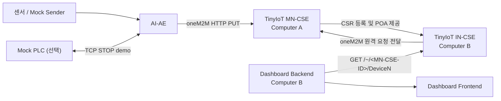

# oneM2M-project

oneM2M 기반 IoT/MEC 안전 모니터링 해커톤 프로젝트입니다. 센서 입력을 AI-AE가 처리하고,
위험도를 TinyIoT MN-CSE에 저장하며, 별도 Monitoring Node의 Dashboard가 IN-CSE 경유로
데이터를 조회하는 구성을 목표로 합니다.

## 구성 요소와 현재 통합 상태

| 구성 요소 | 역할 | 저장소 상태 |
|---|---|---|
| AI-AE | 센서 API, 입력 검증, 위험도 추론, oneM2M 업데이트 및 데모 대응 | 통합됨 |
| TinyIoT MN-CSE | MEC Node에서 oneM2M 리소스와 센서/위험 데이터 제공 | 통합됨 |
| TinyIoT IN-CSE | Monitoring Node에서 MN-CSE 등록과 원격 요청 라우팅 | 소스 및 빌드 진입점 통합됨 |
| PinchGuard Dashboard | 센서/위험 상태 시각화, IN-CSE를 통한 원격 MN-CSE 조회 | 소스 통합됨 |

MEC는 실행 인프라/노드이고 AI-AE는 그 위에서 동작하는 애플리케이션입니다. MN-CSE 및
AI-AE는 **Computer A (MEC Node)**에, IN-CSE 및 Dashboard는 **Computer B (Monitoring
Node)**에 배치하는 것이 기본 토폴로지입니다. 두 배포 패키지는 각각 독립된 설정과 런타임
데이터를 사용합니다.

구현된 패키지 빌드 진입점:

- `packaging/mec/build_package.py`: AI-AE + MN-CSE MEC Package
- `packaging/monitoring/build_package.py`: IN-CSE + Dashboard Monitoring Package

현재 작업 브랜치에서 **실제 두 컴퓨터 간 LAN 연동과 Release 산출물 설치 검증은 아직
완료되지 않았습니다.** 코드/문서의 구현 상태와 실환경 검증 상태를 구분합니다.

## 목표 데이터 흐름



Dashboard는 MN-CSE에 직접 연결하지 않습니다. Dashboard Backend는 같은 Monitoring Node의
IN-CSE에 요청하고, IN-CSE는 등록된 MN-CSE의 도달 가능한 POA를 통해 요청을 전달합니다.
AI-AE는 Computer A의 MN-CSE에 `127.0.0.1`로 접속합니다. 이 loopback 주소는 Computer B에서
MN-CSE에 접속할 주소가 아닙니다.

## AI-AE 주요 동작

- FastAPI 센서 API가 Device1~Device5 입력을 검증하고 최신 프로세스 메모리 상태를 갱신
- Device3의 beam trigger 및 Device4 회전 상태를 조건으로 ML 위험도 추론
- 기존 Seed DB의 고정 Device1~Device6 FlexContainer Resource ID에 oneM2M PUT
- `CRITICAL` 추론일 때 선택적 Mock PLC TCP STOP 요청
- AI-AE는 리소스 생성/ID discovery를 하지 않음. Resource ID와 schema는 Seed DB 및 설정에
  맞아야 함

이 모델과 PLC 동작은 해커톤 데모이며 인증된 산업 안전 제어기가 아닙니다.

## 저장소 구조

```text
oneM2M-project/
├── AI-AE/                    # FastAPI AI Application Entity와 테스트
├── MN-CSE/                   # TinyIoT MN-CSE 소스, Seed DB, build/run 스크립트
├── IN-CSE/                   # TinyIoT IN-CSE 소스, 설정/빌드/실행 스크립트
├── Dashboard/                # PinchGuard Backend, static frontend, 테스트
├── packaging/
│   ├── mec/                  # MEC Package 빌더/제어/템플릿
│   └── monitoring/           # Monitoring Package 빌더/제어/템플릿
├── docs/                     # 아키텍처, 설정, 배포, 개발, 패키징 문서
├── scripts/                  # MEC 실동작 검증 도구
├── .env.example              # 저장소 개발/빌드용 placeholder
└── README.md
```

## 배포 패키지

### MEC Package

AI-AE, TinyIoT MN-CSE, 모델, Seed DB, 런타임 제어 스크립트를 함께 제공합니다. MN-CSE는
MEC 로컬에서 AI-AE 요청을 받고, 설정된 Remote CSE endpoint에 비동기 등록 재시도를 합니다.
기본 대상 플랫폼은 WSL/Linux x86_64입니다.

### Monitoring Package

TinyIoT IN-CSE와 Dashboard Backend/Frontend를 함께 제공합니다. IN-CSE가 MEC MN-CSE 등록을
수락하고, Dashboard가 IN-CSE를 통해 Device1~Device6을 조회합니다. 기본 대상 플랫폼은
WSL/Linux x86_64입니다.

패키지 구조와 한계는 [패키징 가이드](docs/PACKAGING.md), 실제 설치는
[배포 가이드](docs/DEPLOYMENT.md)를 참고하세요. 빌드 스크립트가 있다고 해서 해당 패키지의
실제 배포/두 컴퓨터 연결 검증까지 완료된 것은 아닙니다.

## WSL 개발 및 테스트

개발과 네이티브 C 빌드는 WSL Ubuntu/Linux를 기준으로 합니다. 저장소가 `/mnt/c/`에 있으면
Linux 파일시스템의 `~/projects/oneM2M-project` checkout이 일반적으로 더 빠르지만 기존 작업
파일을 임의로 이동하지 마세요.

```bash
sudo apt-get update
sudo apt-get install -y build-essential pkg-config libssl-dev libwebsockets-dev python3-venv

cp .env.example .env
# .env의 placeholder를 실제 환경에 맞게 수정. 실제 값은 출력/커밋하지 않음.
```

AI-AE:

```bash
cd AI-AE
python3 -m venv .venv
source .venv/bin/activate
python -m pip install -r requirements.txt
python -m pytest -q
```

MN-CSE 빌드 및 실행은 프로젝트 루트에서 합니다. 이 명령은 실제 `.env`와 Seed DB를 읽으므로
필수 설정을 먼저 채웁니다.

```bash
python3 MN-CSE/scripts/build.py
python3 MN-CSE/scripts/run.py
```

IN-CSE 빌드/실행도 프로젝트 루트 `.env` 설정을 사용합니다.

```bash
python3 IN-CSE/scripts/build.py
python3 IN-CSE/scripts/run.py
```

Dashboard 개발 테스트:

```bash
cd Dashboard
python3 -m venv .venv
source .venv/bin/activate
python -m pip install -r requirements.txt -r requirements-camera.txt -r requirements-test.txt
python -m pytest -q
```

실제 환경변수, 개별 실행 절차 및 포트는 [설정 문서](docs/CONFIGURATION.md)와
[개발 가이드](docs/DEVELOPMENT.md)에 있습니다. `.env`, Resource ID, Originator,
인증정보를 README/로그/커밋에 복사하지 마세요.

## 계획 및 미확정 사항

- 두 컴퓨터가 같은 네트워크/방화벽 조건에서 IN-CSE 등록 및 원격 조회를 수행하는 통합 검증
- MEC 및 Monitoring 패키지 각각의 깨끗한 Linux 장비 설치/업데이트 테스트
- 검증된 OS/아키텍처별 GitHub Release와 SHA-256 게시
- 실제 운영 Originator 및 IN-CSE access-control 정책 확정
- 필요 시 TLS, 인증서/키 배포, 로그 회전과 서비스 자동 시작 방식 정의

다중 MEC discovery, 별도 MEC registry, Docker Compose 및 자동 failover는 현재 범위가 아닙니다.

## 추가 문서

- [전체 아키텍처](docs/ARCHITECTURE.md)
- [배포 가이드](docs/DEPLOYMENT.md)
- [환경변수 설정](docs/CONFIGURATION.md)
- [개발 가이드](docs/DEVELOPMENT.md)
- [독립 패키징 가이드](docs/PACKAGING.md)
- [AI-AE 상세 문서](AI-AE/README.md)
- [MN-CSE 상세 문서](MN-CSE/README.md)
- [IN-CSE 상세 문서](IN-CSE/README.md)
- [Dashboard ↔ IN-CSE 연동](Dashboard/README_MN_CSE_INTEGRATION.md)
