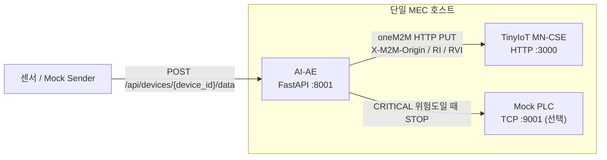

# 단일 MEC AI-AE + MN-CSE 아키텍처

## 범위와 구성 요소

| 구성 요소 | 저장소 내 상태 | 책임 |
|---|---|---|
| MEC 환경 | 단일 컴퓨터/WSL 실행 환경 | AI-AE와 MN-CSE 프로세스를 호스팅 |
| AI-AE | `AI-AE/` | 센서 API, 입력 검증, 최신 상태, 위험도 추론, oneM2M 업데이트 |
| MN-CSE | `MN-CSE/` TinyIoT 소스 루트 | oneM2M 리소스 및 센서/위험 데이터 저장 |
| Mock PLC | AI-AE의 데모 코드 | CRITICAL 시 TCP STOP 요청을 시험하는 선택 컴포넌트 |
| Dashboard | 별도 개발, 소스 미통합 | 이번 통합/실행 범위 외부 |

MEC는 실행 인프라/환경이며 AI-AE는 그 환경에 설치되는 애플리케이션입니다.
현재 구성은 한 컴퓨터에서 AI-AE와 MN-CSE를 실행하는 단일 MEC입니다. CSE 또는 장비의
자동 발견, 다중 MEC 등록, Registry 기능은 포함하지 않습니다.

## 전체 데이터 흐름

Dashboard의 조회 흐름은 소스가 통합되지 않아 표현하지 않습니다.

## AI-AE 내부 처리

1. FastAPI endpoint는 device1~device5 JSON payload를 받습니다.
2. `device_schemas.py`는 해당 기기의 필드와 자료형을 검사합니다.
3. 유효한 최신 값은 `LatestSensorState`의 프로세스 메모리에 저장됩니다.
4. SensorTriggerEngine은 `device3.beam_blocked=true`이고 최신 `device4.is_rotating=true`인
   경우에 모델을 실행합니다.
5. 입력 feature는 Device1의 인원수, Device4의 회전 속도, Device5의 거리입니다.
6. 센서 값은 Device1~5 각 FlexContainer를 업데이트하고, 추론 결과는 Device6 Risk
   FlexContainer로 전송합니다.
7. 예측이 `CRITICAL`이면 AI-AE가 PLC TCP STOP 요청을 시도합니다.

AI-AE 최신 값은 메모리에만 유지되고 CSE 기록은 oneM2M 리소스 업데이트를 통해 별도로
영속화됩니다. 별도 메시지 큐나 데이터베이스를 통한 Layer 1/Layer 2 분리는 없습니다.

## AI-AE와 MN-CSE 간 통신

- AI-AE base URL: `http://127.0.0.1:3000`
- MN-CSE HTTP listener: port `3000`
- 메서드: `PUT`
- 성공 기준: HTTP `200`, `X-M2M-RSC: 2004`, 요청/응답 `X-M2M-RI` 일치
- 요청 헤더: `X-M2M-Origin`, `X-M2M-RI`, `X-M2M-RVI`
- CSE Base Name: `.env`의 AI-AE/TinyIoT 설정이 동일해야 함
- RVI: `.env`의 `CSE_RVI`를 TinyIoT 컴파일 설정에도 동일하게 적용
- AI-AE는 리소스를 생성하거나 ID를 발견하지 않고 고정 Resource ID로 update만 수행

### SERVER_IP와 bind 주소

TinyIoT `httpd.c`의 `start_server()`는 `0.0.0.0`에 bind합니다. 반면 `util.c`는
`SERVER_IP`를 CSE의 `poa` 주소에 기록합니다. 따라서:

- `TINYIOT_SERVER_IP`는 광고되는 POA IP입니다.
- `TINYIOT_SERVER_PORT`는 listener port이면서 POA의 port입니다.
- AI-AE 연결 주소는 별도 설정 `CSE_BASE_URL`로 지정합니다.
- 이번 단일 컴퓨터 설정에서는 POA IP와 AI-AE 연결 주소를 모두 loopback으로 맞추지만,
  두 설정은 의미가 다르며 일반적으로 같은 값이어야 하는 것은 아닙니다.

## 고정 리소스와 DB 배치

`MN-CSE/data.db`는 빈 DB가 아니라 CSE Base 및 관련 리소스와 여섯 FlexContainer를 포함한
seed DB입니다. AI-AE `.env`의 Device1~Device6 Resource ID는 seed의 ID와 모두 일치하며,
각 FlexContainer의 custom field도 AI-AE payload와 일치합니다.

TinyIoT의 `init_dbp()`는 현재 작업 디렉터리의 `data.db`를 열고 빠진 테이블을 생성합니다.
빈 DB에 기존 Resource를 자동 복원하지는 않습니다. `init_server()`는 CSE Base가 없을 때
Base를 만들지만 여섯 custom FlexContainer를 생성하지 않습니다.

따라서 seed와 runtime DB 분리가 적절합니다. `scripts/run.py`는 seed를 첫 실행에만
`runtime/data.db`로 복사하고, 이후 runtime DB를 유지합니다. `data.db`는 ID가 고정된
초기 템플릿으로 보존해야 합니다.

## 빌드 구성

`configure.ac`는 `AC_CONFIG_HEADERS([config.h])` 및 `AC_CONFIG_FILES([Makefile])`를
선언하므로 전통적인 Autoconf 흐름에서는 `config.h.in` 및 `Makefile.in`에서 두 파일이
생성됩니다. 다만 기존 configure 옵션은 Base SP ID/RVI를 받지 않고, `autogen.sh`는
대화형이며 기존 `Makefile.in`도 현재 SQLite/웹소켓 소스 구성과 맞지 않았습니다.

통합 실행은 이를 피하도록 `MN-CSE/scripts/build.py`가 루트 `.env`를 읽고
`config.h.in`, `Makefile.in`을 기반으로 `config.h`, `Makefile`을 생성한 다음 `make`를
실행합니다. 즉 현재 지원되는 빌드 진입점은 Autoconf `autogen.sh`가 아니라 이 Python
스크립트입니다. 자동 생성된 `config.h`는 직접 수정하지 않습니다. 생성 파일은 MN-CSE
`.gitignore`에 포함됩니다.

## 현재 범위 밖

- Dashboard와의 API/조회 프로토콜
- IN-CSE, Registrar CSE, Remote CSE 등록
- 다중 MEC Discovery 및 MEC Registry
- 자동 Resource ID 할당
- Docker 및 Compose
