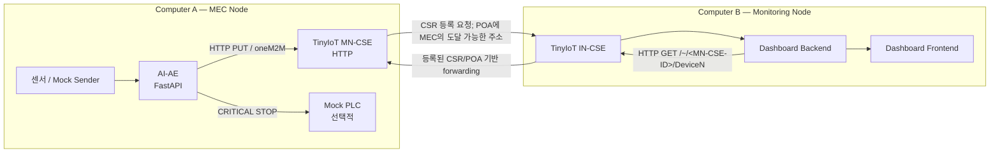

# 통합 시스템 아키텍처

## 컴포넌트 경계

| 컴포넌트 | 기본 배치 | 책임 |
|---|---|---|
| AI-AE | MEC Node | 센서 payload 검증, 최신 상태 관리, ML 위험도 추론, 고정 리소스 update |
| TinyIoT MN-CSE | MEC Node | AI-AE의 oneM2M 요청 수신, Device1~Device6 리소스 제공 및 원격 POA 광고 |
| TinyIoT IN-CSE | Monitoring Node | MN-CSE Remote CSE 등록 수락, oneM2M 원격 요청 전달 |
| PinchGuard Dashboard | Monitoring Node | UI 제공, Backend polling 및 센서/위험 정보를 표시 |
| Mock PLC | 개발/demo용 | AI-AE의 CRITICAL STOP 흐름을 모의하는 TCP endpoint |

MEC는 노드/실행 환경이고 AI-AE는 MEC에서 실행되는 애플리케이션입니다. IN-CSE는 이번
배포 구조의 통합/라우팅 서비스 계층이며 Dashboard UI 자체와는 다른 프로세스입니다.

## 배치 및 관계

CSR 등록은 MEC의 MN-CSE가 Monitoring Node IN-CSE를 향해 시작합니다. Dashboard는 Browser에서
MN-CSE를 직접 호출하지 않고 Dashboard Backend를 통해 IN-CSE에 요청합니다. IN-CSE가 등록된
MN-CSE POA로 요청을 전달합니다.

## 데이터 흐름

1. 센서 또는 Mock Sender가 AI-AE HTTP API에 측정 feature를 보냅니다.
2. AI-AE가 device별 schema와 값을 검증하고 프로세스 메모리의 최신 상태를 갱신합니다.
3. Trigger 조건에서 ML 모델이 위험도를 추론합니다. CSV 라벨은 입력으로 전송하지 않습니다.
4. AI-AE가 Device1~Device5의 고정 FlexContainer Resource ID를 갱신하고 위험 결과를 Device6에
   기록합니다.
5. 필요하면 `CRITICAL` 처리에서 AI-AE가 Mock PLC에 STOP demo 요청을 보냅니다.
6. MN-CSE는 설정된 Remote CSE endpoint에 등록을 시도합니다. IN-CSE가 사용 가능하지 않아도
   MEC 로컬 MN-CSE는 서비스를 시작하고 백그라운드에서 재시도합니다.
7. Dashboard Backend는 `GET /~/<MN-CSE-ID>/Device1`부터 Device6까지를 IN-CSE에 요청합니다.
   한 리소스 요청 실패가 나머지 요청을 숨기지 않습니다.

MN-CSE Remote CSE registration과 Dashboard routing은 소스상 구현되어 있으나, 이 문서 갱신
시점의 두 컴퓨터 간 동작 결과를 성공으로 간주하지 않습니다.

## 통신 관계 및 주소

| From → To | 프로토콜 / URI | 사용처 |
|---|---|---|
| 센서 → AI-AE | HTTP, AI-AE API | 센서 입력 |
| AI-AE → MN-CSE | oneM2M HTTP Binding, `CSE_BASE_URL` | Resource update |
| MN-CSE → IN-CSE | oneM2M HTTP, `REMOTE_CSE_*` | CSR 확인/등록 및 Remote CSE metadata 조회 |
| Dashboard Backend → IN-CSE | oneM2M HTTP, `/~/<MN-CSE-ID>/DeviceN` | 원격 센서/위험 조회 |
| IN-CSE → MN-CSE | oneM2M HTTP forwarding, 등록된 POA | Dashboard 요청 전달 |
| AI-AE → Mock PLC | TCP | 선택적 CRITICAL demo |

주소 구분:

- AI-AE 로컬 요청: `CSE_BASE_URL` 기본 통합 형태는 `http://127.0.0.1:<MN-CSE-port>`.
- MN-CSE listener: 코드에서 `0.0.0.0`에 bind합니다. `TINYIOT_SERVER_IP`는 listener bind가
  아니라 MN-CSE가 광고하는 POA 주소이며 Monitoring Node에서 도달 가능해야 합니다.
- IN-CSE listener: HTTP server의 `0.0.0.0` bind이며, `IN_CSE_SERVER_IP`는 광고 주소입니다.
- Dashboard → IN-CSE: 기본 토폴로지에서는 같은 Monitoring Node이므로 loopback을 사용할 수
  있습니다.
- Dashboard/IN-CSE → MEC MN-CSE: MEC Node의 도달 가능한 네트워크 주소를 사용해야 합니다.
  원격 MN-CSE 연결 주소에 `127.0.0.1`을 사용하면 안 됩니다.

포트 기본 예시는 MEC의 MN-CSE `3000`, Monitoring의 IN-CSE `3001`, Dashboard `8000`,
AI-AE `8001`, Mock PLC `9001`입니다. 포트는 배포 설정 및 실행 인자에 따라 달라질 수 있으므로
실제 `.env` 값과 방화벽 정책을 확인합니다.

## 데이터/영속성 경계

- `MN-CSE/data.db`: Device1~Device6 및 Base 정보가 들어 있는 Seed DB. 직접 수정하지 않습니다.
- MEC Package의 `runtime/data.db`: 최초 실행에만 Seed를 복사하고 이후에는 보존합니다.
- IN-CSE의 runtime DB: CSE 시작 시 runtime working directory에서 생성/사용합니다.
- Dashboard SQLite: `PG_DB_PATH`가 가리키는 runtime 파일에 저장합니다.
- 로그와 PID 파일은 패키지별 `runtime/logs`와 `runtime/pid`에 둡니다.
- 모델 파일은 AI-AE 실행 파일과 별도로 패키지의 `models/`에 포함됩니다.

## 현재 범위 밖

- 다중 MEC discovery, Registry/IN-CSE 기반 MEC 선택, failover
- 인증/인가 정책의 운영 승인, TLS 종단 및 인증서 자동 갱신
- Windows/macOS 및 ARM 플랫폼의 패키지 지원
- 실환경에서 검증되지 않은 자동 기동·재부팅 복구
