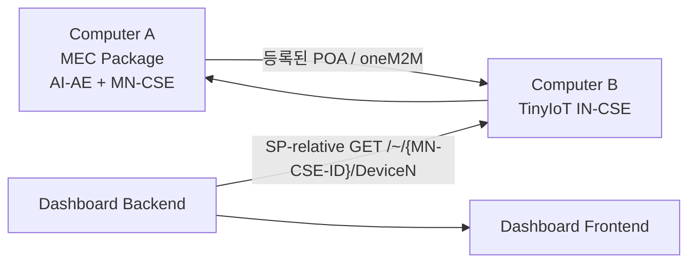

# PinchGuard Monitoring Package

> **Computer B · Monitoring Node**
> TinyIoT IN-CSE와 PinchGuard Dashboard를 제공하는 독립 실행 패키지입니다. 소스 코드나
> 개발용 Python 환경 없이 Linux x86_64 장비에서 실행하는 것을 목표로 합니다.

**센서·위험 데이터 흐름:** AI-AE → MEC MN-CSE → Monitoring IN-CSE → Dashboard

이 패키지는 MEC MN-CSE 바이너리를 포함하지 않습니다. Computer A에는 별도의
[MEC Package](../../packaging/mec/README.md)를 설치해야 합니다.

## 목차

1. [패키지 구성과 연결 구조](#01--패키지-구성과-연결-구조)
2. [최초 설치와 사용자가 입력할 값](#02--최초-설치와-사용자가-입력할-값)
3. [MEC Package와 연결](#03--mec-package와-연결)
4. [실행·상태 확인·종료](#04--실행상태-확인종료)
5. [포트·방화벽·데이터 보존](#05--포트방화벽데이터-보존)
6. [패키지 빌드 안내](#06--패키지-빌드-안내)
7. [검증 범위와 제한](#07--검증-범위와-제한)

## 01 / 패키지 구성과 연결 구조



Dashboard Backend는 같은 Monitoring Node의 IN-CSE에 요청합니다. IN-CSE는 등록된 MEC
MN-CSE로 요청을 전달합니다. Dashboard에서 MEC의 `127.0.0.1`을 주소로 설정하지 않습니다.

패키지는 IN-CSE/Dashboard 실행 파일, static 파일, 설정 템플릿, 실행 스크립트와
`runtime/` 저장 공간으로 구성됩니다. CSE Base identity와 고정 MEC Seed DB에 대한 허용
정책은 패키지 빌드 시 설정됩니다. 설치 사용자는 장비마다 달라지는 주소와 키를 입력합니다.

## 02 / 최초 설치와 사용자가 입력할 값

1. Linux x86_64 장비에 Monitoring Package 압축을 풉니다.
2. 패키지 디렉터리에서 설정 파일을 생성합니다.

```bash
./scripts/configure-monitoring
```

3. 생성된 `config/.env`에서 아래 **운영자 입력 항목**을 설정합니다.

| 변수 | 입력할 값 | 안내 |
|---|---|---|
| `IN_CSE_SERVER_IP` | Computer B의 MEC에서 도달 가능한 내부망 주소 | IN-CSE POA에 광고됩니다. `127.0.0.1` 금지 |
| `PG_IN_CSE_ORIGIN` | MEC Package의 `AE_ID`와 동일한 Originator | MN-CSE Seed DB가 허용한 ID를 입력 |
| `PG_INGEST_KEY` | 충분히 긴 임의 API key | 최소 16자. 실제 값을 문서·issue·로그에 복사하지 않음 |
| `PG_DASHBOARD_HOST` | Dashboard listen 주소 | 기본 `0.0.0.0`; 네트워크 정책에 맞게 제한 가능 |
| `PG_DASHBOARD_PORT` | 브라우저 접속 포트 | 기본 `8000`; 방화벽과 실제 포트가 일치해야 함 |
| `IN_CSE_SERVER_PORT` | IN-CSE listen 포트 | 기본 `3001`; 변경 시 Computer A의 `REMOTE_CSE_PORT`도 동일하게 변경 |

나머지 값은 패키지 기본값 또는 빌드 metadata에서 준비됩니다.

| 변수 | 설정 방법 |
|---|---|
| `PG_IN_CSE_URL` | 같은 장비의 IN-CSE를 가리키는 기본 loopback 주소. 변경하지 않는 것을 권장 |
| `PG_MN_CSE_ID`, `PG_IN_CSE_RVI`, `PG_MN_DEVICE1_RI`~`PG_MN_DEVICE6_RI` | `configure-monitoring`이 패키지 metadata에서 채움 |
| `PG_DB_PATH` | 기본값은 `runtime/pinchguard.sqlite3`; 기존 데이터 위치를 유지 |
| `PG_ENABLE_DEMO`, `PG_DEMO_SEED` | 기본 비활성. Demo/sample event를 운영 데이터로 오인하지 않도록 유지 |
| polling/freshness 값 | 기본값을 사용하거나 사전 테스트 후 조정 |

`configure-monitoring`은 기존 `config/.env`를 덮어쓰지 않습니다. 최초 설정 뒤 Originator를
바꾸면 IN-CSE의 초기 AccessControl 정책과 맞지 않을 수 있습니다. **첫 기동 전에 확정하고
운영 중 그대로 유지하세요.**

## 03 / MEC Package와 연결

두 패키지는 같은 프로젝트 빌드에서 생성한 한 쌍을 사용해야 합니다. Monitoring Package의
`config/build-info.json`에는 MEC 설정에 사용할 IN-CSE Base Name 및 CSE ID가 포함됩니다.
그 값을 Computer A의 MEC Package `config/.env`에 설정합니다.

| Computer A · MEC 설정 | 값 출처 |
|---|---|
| `REMOTE_CSE_ID` | Monitoring Package `build-info.json`의 IN-CSE ID. CSE ID 형식에 맞춰 입력 |
| `REMOTE_CSE_NAME` | 같은 metadata의 IN-CSE Base Name |
| `REMOTE_CSE_HOST` | Computer B의 내부망 주소. URL scheme/port 없이 host만 입력 |
| `REMOTE_CSE_PORT` | Computer B의 `IN_CSE_SERVER_PORT` |
| `TINYIOT_SERVER_IP` | Computer B에서 접근 가능한 Computer A의 MEC 주소 |

`PG_MN_CSE_ID`는 현재 패키지의 고정 MEC Seed DB와 연결됩니다. 다른 MN-CSE identity를 가진
패키지와 임의로 섞지 마세요. MEC 쪽 설정·기동 순서는
[MEC Package 안내](../../packaging/mec/README.md)를 참고하세요.

## 04 / 실행·상태 확인·종료

```bash
./scripts/start-monitoring
./scripts/status-monitoring
./scripts/healthcheck
```

기동기는 설정 검증 → IN-CSE 시작 및 CSE Base health 확인 → Dashboard 시작 및 `/health`
확인 순으로 실행합니다. MEC가 오프라인이어도 두 로컬 서비스는 시작할 수 있습니다.
`status-monitoring`에서 로컬 health와 MEC 연결 상태를 별도로 확인하세요. 로컬 health가
정상이더라도 MEC가 연결됐다는 뜻은 아닙니다.

브라우저 접속 주소는 다음 형식입니다.

```text
http://<Computer-B-address>:<PG_DASHBOARD_PORT>
```

종료:

```bash
./scripts/stop-monitoring
```

로그는 `runtime/logs/`, PID 파일은 `runtime/pid/`, Dashboard SQLite는 설정된
`PG_DB_PATH`에 저장됩니다.

## 05 / 포트·방화벽·데이터 보존

| 포트 | 방향 | 목적 |
|---:|---|---|
| `3001` (기본) | Computer A → Computer B | IN-CSE 등록 및 원격 요청 전달 |
| `3000` (기본) | Computer B → Computer A | MEC MN-CSE POA |
| `8000` (기본) | 사용자 브라우저 → Computer B | Dashboard UI/API |

실제 포트는 각 패키지 설정을 기준으로 합니다. 필요한 내부망 경로만 방화벽에서 허용하고,
IN-CSE/MN-CSE API를 인터넷 전체에 공개하지 마세요. 현재 패키지는 HTTP를 사용하며 TLS
종단을 구성하지 않습니다. 신뢰된 내부망/VPN과 방화벽 정책을 전제로 합니다.

기동/업데이트 때 `runtime/`을 삭제하거나 덮어쓰지 마세요. 업데이트 전에 SQLite 및 로그를
백업합니다. stop 스크립트는 이 패키지의 기록된 프로세스만 대상으로 합니다.

## 06 / 패키지 빌드 안내

이 절차는 **최종 다운로드 사용자가 아니라 패키지 제작자**를 위한 내용입니다. 빌드 환경은
WSL Ubuntu/Linux x86_64입니다. 프로젝트 루트 `.env`에는 MEC의 `CSE_RVI`와
`TINYIOT_CSE_BASE_SP_ID`가 필요합니다. Monitoring Package의 CSE Base identity와 고정
MEC Seed ID는 빌드 스크립트가 구성하므로 루트 `.env`에 Monitoring 장비 주소나 사용자별
Originator를 넣을 필요가 없습니다. 패키지 사용자는 `PG_IN_CSE_ORIGIN`에 MEC Package의
`AE_ID`를 입력해야 합니다. 이 ID는 IN-CSE의 조회 정책과 MN-CSE Seed DB의 읽기 권한에
모두 사용됩니다.

```bash
python3 -m venv packaging/monitoring/.venv
source packaging/monitoring/.venv/bin/activate
python -m pip install -r packaging/monitoring/requirements-build.txt
python packaging/monitoring/build_package.py
```

기본 출력은 `packaging/monitoring/dist/` 아래의 Linux x86_64 패키지 디렉터리,
`.tar.gz`, SHA-256 checksum입니다. 기존 결과는 덮어쓰지 않습니다. 이 build 완료만으로
별도 장비에서 설치나 Computer A/B 간 통신이 검증되는 것은 아닙니다.

## 07 / 검증 범위와 제한

- 지원 대상으로 표시된 플랫폼: **Linux x86_64만**
- Dashboard는 상태·센서·위험 정보를 보여주는 소프트웨어 시제품이며 인증된 산업 안전
  제어기가 아닙니다.
- Demo/Mock 데이터와 실제 센서 입력을 구분해야 합니다.
- 두 컴퓨터 간 LAN 연결, 실제 방화벽, 재부팅 복구, TLS/인증 배치는 설치 환경에서 검증해야
  합니다. 수행하지 않은 테스트를 성공으로 간주하지 않습니다.
- 다중 MEC discovery, 자동 MEC 선택, failover는 포함하지 않습니다.
